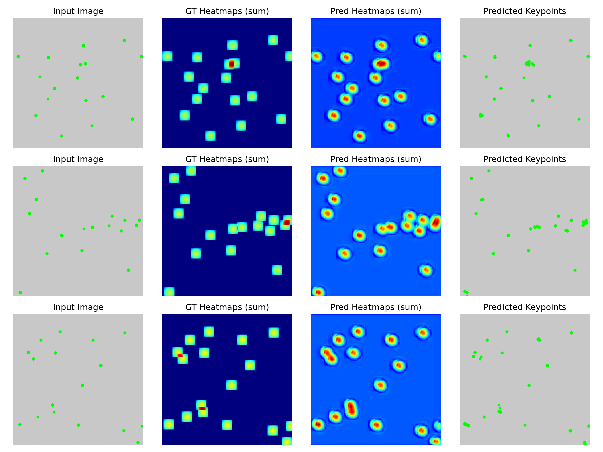

# 2D Human Pose Estimation

Convolutional neural network for detecting 17 keypoints (COCO format)
on human bodies in images.

<p align="center"><br>
<em>Synthetic inputs, target heatmaps, predicted heatmaps and decoded keypoints.</em></p>

**Data note:** this project uses a small procedurally generated (synthetic) dataset built in `src/dataset.py` (200 training / 50 test images of random keypoints on a plain background, 17 keypoints in COCO order), not real images. It is a didactic implementation: the numbers below show that the pipeline trains, and are not comparable to benchmark results.

## Architecture
Encoder-decoder network that predicts per-keypoint heatmaps.

## Installation
```bash
pip install -r requirements.txt
```

## Usage
```bash
python src/train.py
python src/evaluate.py
```

## Results

| Metric | Value |
|---|---|
| Heatmap MSE, synthetic test set (final epoch) | 0.0033 |
| Epochs | 10 |

<p align="center"></p>

## Author
Hessam Kaveh — Research Fellow, Italian Institute of Technology

## License

Released under the [MIT License](LICENSE).
