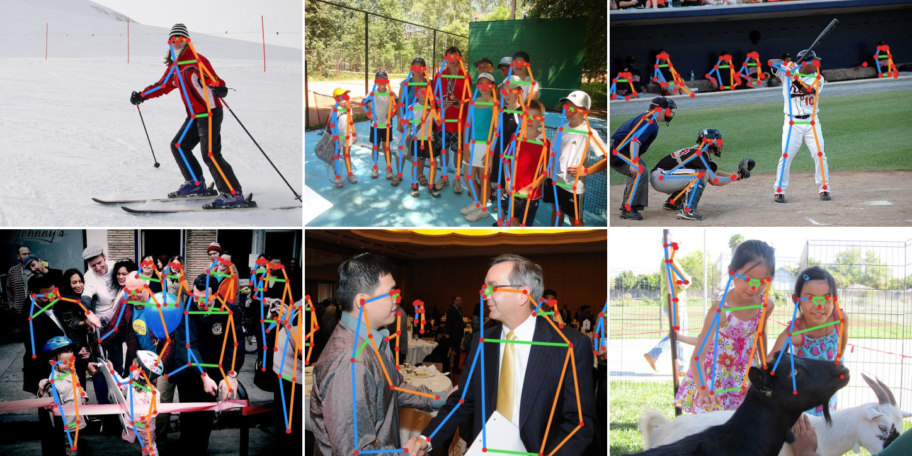
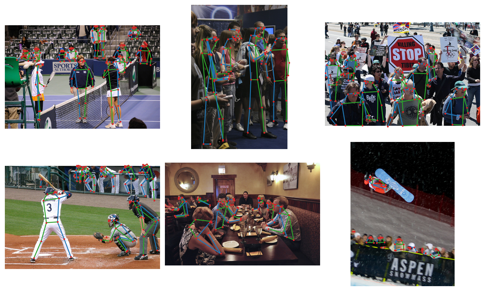
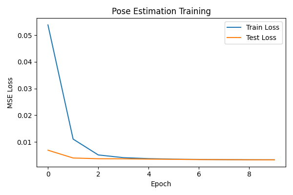

# 2D Human Pose Estimation on COCO (SimpleBaseline, ResNet-50)

[](https://github.com/HessamKaveh/human-pose-estimation/actions/workflows/ci.yml)   [](LICENSE)

A from-scratch PyTorch reimplementation of the top-down **SimpleBaseline** pose estimator (Xiao et al., *Simple Baselines for Human Pose Estimation and Tracking*, ECCV 2018). It is trained on the full **COCO-2017 keypoints** set (149,813 annotated people) and evaluated with the official COCO OKS metric on val2017.

<p align="center"></p>

*Fully automatic top-down pipeline on unseen COCO val2017 images (Flickr photos, Creative Commons licences listed in the COCO annotations): person boxes from an off-the-shelf COCO YOLO11s detector, keypoints from our SimpleBaseline-R50 with flip test. Orange = left limbs, blue = right.*

## Results: COCO val2017, ground-truth person boxes

| Model | Input | Epochs | **AP** | AP50 | AP75 | AP (M) | AP (L) | AR |
|---|---|---|---|---|---|---|---|---|
| SimpleBaseline ResNet-50 (ours, GT boxes) | 256×192 | 20 | **68.7** | 90.4 | 76.0 | 66.2 | 72.5 | 72.0 |
| SimpleBaseline ResNet-50 (paper, detected boxes) | 256×192 | 140 | 70.4 | 88.6 | 78.3 | 67.1 | 77.2 | 76.3 |

The paper row uses detected person boxes (56.4 person AP detector) rather than ground-truth boxes, so the two rows are a reference point, not a strict comparison.

**Notes:**
- With **1/7 of the paper's schedule** (20 epochs, a 4-hour budget on a 4 GB laptop GPU), the model reaches 68.7 AP, within ~2 AP of the paper's 140-epoch number. The loss curve was still falling at the end, so a longer schedule would improve it further.
- **Large people are easier than medium ones** (72.5 vs 66.2 AP). At 256×192 a medium-sized person covers few heatmap pixels, so quantisation error dominates.
- **Sanity check of the evaluation pipeline:** encoding the ground-truth keypoints to heatmaps and decoding them back gives **96.1 AP**. Crop, affine warp, heatmap decoding and the COCO evaluation are therefore consistent, and the remaining gap is the model's.

<p align="center"></p>

*Predictions on unseen val2017 images (GT person boxes, 17 COCO keypoints).*

<p align="center"></p>

## Method

| | |
|---|---|
| Model | ImageNet ResNet-50 → 3 × (deconv 4×4 stride 2, 256 ch, BN, ReLU) → 1×1 conv to 17 heatmaps |
| Input / output | 256×192 person crop → 17 heatmaps at 64×48, Gaussian σ = 2 |
| Person crop | box expanded to a 3:4 aspect ratio and ×1.25, then affine-warped |
| Augmentation | random scale ±35 %, rotation (σ = 45°, p = 0.6), horizontal flip with left/right joint swap |
| Loss | joints-MSE on heatmaps; invisible / out-of-crop joints are masked out |
| Optimiser | AdamW (lr 1e-3, wd 1e-4), one-cycle schedule, batch 32, AMP, channels-last |
| Test | flip test (heatmaps averaged with the flipped, joint-swapped, 1-px shifted prediction); arg-max + quarter-pixel shift toward the higher neighbour; inverse affine to image coordinates |
| Metric | official `pycocotools` COCOeval, keypoints (OKS) |

## Dataset

[COCO 2017](https://cocodataset.org/#keypoints-2017): train2017 images (18 GB), val2017 images and the `person_keypoints_*.json` annotations.

```bash
wget http://images.cocodataset.org/zips/train2017.zip http://images.cocodataset.org/zips/val2017.zip \
     http://images.cocodataset.org/annotations/annotations_trainval2017.zip
unzip -q train2017.zip; unzip -q val2017.zip; unzip -q annotations_trainval2017.zip
export COCO_ROOT=$PWD
```

## Usage

```bash
pip install -r requirements.txt
python src/train.py --backbone resnet50 --hours 4      # or --epochs 140 for the paper schedule
python src/evaluate.py --backbones resnet50            # COCO AP, prediction figure, training curve
```

## Repository layout

```
src/dataset.py    COCO person crops, affine warp, heatmap targets, augmentation
src/model.py      SimpleBaseline (ResNet backbone + deconvolution head)
src/train.py      training loop (time budget, AMP, resume)
src/evaluate.py   flip test, sub-pixel decoding, COCOeval, figures
results/          coco_val2017_gt_boxes.json, training history, figures
```

## Author
Hessam Kaveh — Research Fellow, Italian Institute of Technology (IIT)

## License

Released under the [MIT License](LICENSE).
